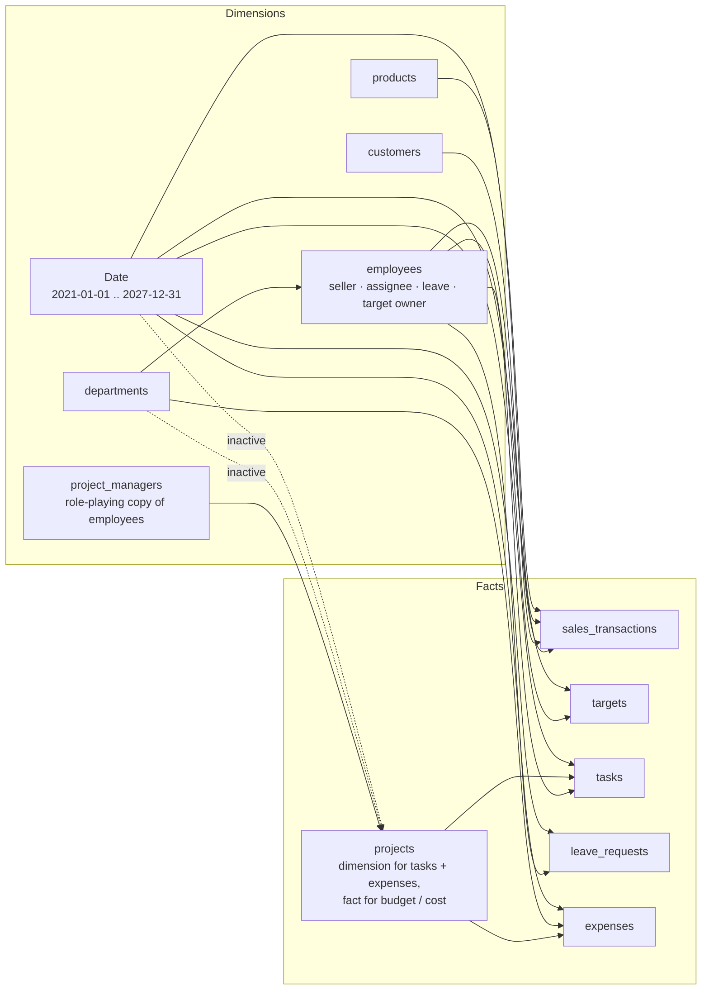

# Phase 2: Data model

Built on 17 Nov 2026 by `tools/build-pbip.ps1`, loaded in Power BI Desktop, tested with DAX queries (`tools/model.ps1`) and saved as `BOI360.pbix`.

## The model



Every relationship is **many-to-one** and **single direction**: the filter flows from the "one" side (dimension) to the "many" side (fact). There are no bidirectional and no many-to-many relationships.

## Relationships (22)

| # | From (many) | To (one) | Active | Why |
|---|---|---|---|---|
| 1 | employees.department_id | departments.department_id | ✅ | An employee's home department |
| 2 | sales_transactions.seller_id | employees.employee_id | ✅ | Role: **seller** |
| 3 | targets.employee_id | employees.employee_id | ✅ | Role: **target owner** (same 8 sellers) |
| 4 | tasks.assignee_id | employees.employee_id | ✅ | Role: **assignee** |
| 5 | leave_requests.employee_id | employees.employee_id | ✅ | Role: **requester** |
| 6 | sales_transactions.customer_id | customers.customer_id | ✅ | |
| 7 | sales_transactions.product_id | products.product_id | ✅ | |
| 8 | projects.project_manager_id | project_managers.project_manager_id | ✅ | Role: **project manager** (separate table, see below) |
| 9 | tasks.project_id | projects.project_id | ✅ | |
| 10 | expenses.project_id | projects.project_id | ✅ | 42 expenses have no project and go to the blank member |
| 11 | expenses.department_id | departments.department_id | ✅ | The **spending** department |
| 12 | projects.department_id | departments.department_id | ❌ | Inactive to avoid ambiguity (below). Project measures use `USERELATIONSHIP` |
| 13 | sales_transactions.transaction_date | Date.Date | ✅ | |
| 14 | targets.target_month | Date.Date | ✅ | First day of each month |
| 15 | expenses.expense_date | Date.Date | ✅ | |
| 16 | tasks.due_date | Date.Date | ✅ | Tasks are analysed by when they are due |
| 17 | tasks.created_date | Date.Date | ❌ | For "tasks created" measures |
| 18 | leave_requests.start_date | Date.Date | ✅ | A leave counts in the month it starts |
| 19 | leave_requests.end_date | Date.Date | ❌ | |
| 20 | projects.start_date | Date.Date | ❌ | Inactive, see below |
| 21 | projects.deadline | Date.Date | ❌ | For "deadline in period" measures |
| 22 | employees.hire_date | Date.Date | ❌ | For "hires per year" |

## Decisions and why

### 1. Two employee tables, not four

The data dictionary warns that employees play several roles. The question is which roles can share one table.

- **Seller, target owner, assignee and leave requester share `employees`.** Each of these roles points at a *different* fact table, and those fact tables are not connected to each other. A filter on one employee therefore has exactly one path to each fact. Selecting E019 shows E019's sales, targets, tasks and leave, which is what you'd expect from an "employee" slicer.
- **The project manager gets its own table, `project_managers`.** Tasks can be reached from an employee in two ways: directly as the assignee (employee → tasks), or through a project they manage (employee → projects → tasks). Power BI refuses two active paths between the same two tables (an *ambiguous path*). A separate role-playing table answers both questions cleanly:
  - `employees[employee_id] = "E039"` gives 1 task (assigned to E039).
  - `project_managers[project_manager_id] = "E039"` gives 3 tasks (on E039's projects).

`project_managers` is a DAX calculated table: a filtered copy of `employees` holding only the 15 managers, plus the manager's department. It refreshes with the model, so there is no duplicate data to maintain.

### 2. Department → projects is inactive

With departments → employees → tasks *and* departments → projects → tasks both active, a department filter could reach tasks by two routes. The same is true for expenses: departments → expenses, and departments → projects → expenses. Only one route can be active.

Each fact keeps the department that matters for it:

| Fact | "Department" means | Path |
|---|---|---|
| expenses | the department that **spent** the money | direct (rel. 11) |
| tasks, leave, targets, sales | the department of the **employee** | through employees (rel. 1) |
| projects (budget, cost) | the project's **owning** department | `USERELATIONSHIP` inside the project measures (rel. 12) |

This matters for the data: 84 of the 108 project expenses are booked by a department other than the project's owner (data quality issue #3). With the expense department as the active path, Finance totals by department are always the booking department.

### 3. Date → projects is inactive

Date → tasks (due date) is active, and projects → tasks is active. An active Date → projects relationship would create a second route from Date to tasks, so the project date relationships are inactive. Project timing measures, such as "deadlines this month", turn one on with `USERELATIONSHIP`.

### 4. One Date table, marked as the date table

- **Range:** `CALENDAR(DATE(2021,1,1), DATE(2027,12,31))`, 2,556 days. It covers the earliest hire date (2021-01-19) and the latest project deadline (2027-02-21).
- **Columns:**
  - Year, Quarter, Month Number, Month, Year Month Number, Year Month, Month Start
  - Weekday Number, Weekday, Is Weekend
- **Sorting:** text columns are sorted by their number column, so Jan → Dec rather than alphabetically.
- **Marked as date table:** the table has `dataCategory: Time` and `Date` is its key. Time-intelligence functions (`DATEADD`, `DATESINPERIOD`, `TOTALYTD`) rely on this.
- **Auto date/time is off** (Phase 1), so Power BI doesn't create a hidden date table for each date column.

### 5. Hidden columns

- **Foreign keys on fact tables are hidden** (seller_id, customer_id, project_id, etc.). Report builders filter through the dimension instead, which always gives the right path.
- **`monthly_salary_tnd` is hidden.** Hiding is only for convenience, not security: a hidden column can still be queried. Real protection needs object-level security, which is out of scope for this exercise.
- **`achievement_pct` is hidden** so nobody sums percentages; achievement is recalculated in Phase 3.

## The "(Blank)" member

`projects` has a virtual blank row, because 42 expenses have no project. That blank project has no department, manager or dates, so the blank row cascades through the inactive relationships: `departments` lists 7 values (6 + blank), `project_managers` 16 and `Date` 2,557.

This is normal Power BI behaviour, not a data error. In Phase 4, department, project and manager slicers get the filter *"is not (Blank)"*. In expense visuals the blank project is relabelled "No project".

## Validation (run against the loaded model)

| Test | Result |
|---|---|
| All 22 relationships | State *Ready*, many-to-one, single direction |
| Date table | 2,556 rows, 2021-01-01 → 2027-12-31, marked as date table |
| Revenue by month adds up | 12 months, sum = 3,650,199.57 (Dec 2026 has targets but no sales, as expected) |
| Department → employees | 8 per department, 48 total |
| Department → tasks (via assignee) | 18 + 18 + 9 + 20 + 13 + 12 = 90 ✅ |
| Department → expenses (spending dept) | sum = 653,371.38 ✅ |
| Department → sales (seller dept) | all 3,650,199.57 under Sales ✅ |
| Department → projects without `USERELATIONSHIP` | 18 for every department, so the inactive relationship really is inactive ✅ |
| Department → projects with `USERELATIONSHIP` | Sales 6 / Operations 7 / IT 5 = 18; budget 645,000 + 720,000 + 390,000 = 1,755,000 ✅ |
| Project → expenses | with project 475,191.75 + no project 178,179.63 = 653,371.38 ✅ |
| PM role vs assignee role (E039) | manages 3 tasks, assigned 1 task: separate roles ✅ |
| Inactive date relationships with `USERELATIONSHIP` | tasks created Mar 2026 = 9; deadlines 2026 = 15, 2027 = 3; hired 2023 = 13 ✅ |

## How to see it in Power BI Desktop

1. Open `exercice2\BOI360.pbix`.
2. Click **Model view** (third icon in the left bar).
   - Solid lines are active relationships; dotted lines are inactive.
   - Double-click a line to see its cardinality and cross-filter direction.
3. **Data** pane › **Date** table: the calendar icon shows it's marked as a date table.
4. To try a filter path yourself, in **DAX query view** (fourth icon) run:

   ```dax
   EVALUATE
   SUMMARIZECOLUMNS(
       departments[department_name],
       "Tasks (by assignee)", COUNTROWS(tasks),
       "Projects (owner)", CALCULATE(COUNTROWS(projects), USERELATIONSHIP(projects[department_id], departments[department_id]))
   )
   ```
