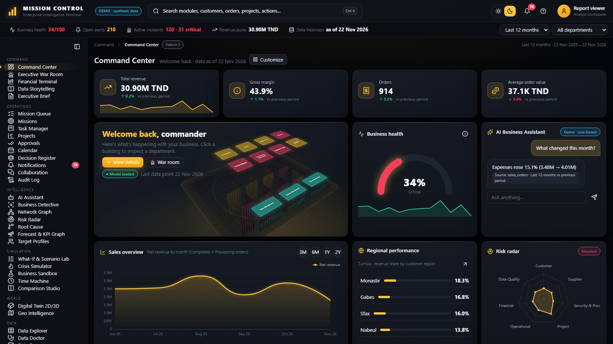
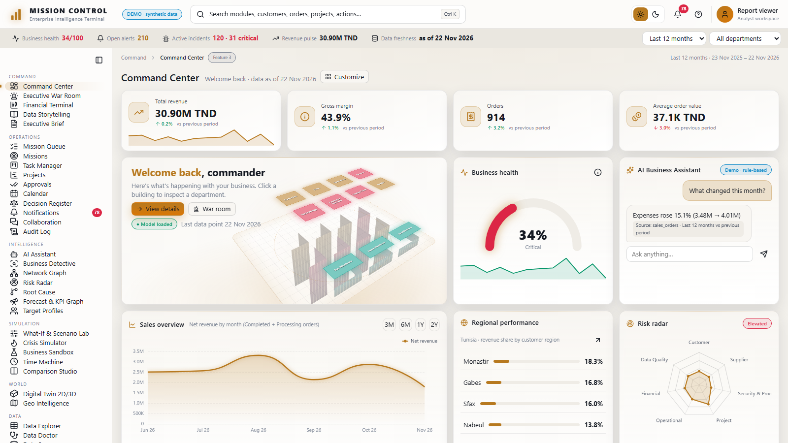

# MISSION CONTROL — Enterprise Intelligence Terminal (exercice3)

This is a Power BI report built on the synthetic *Mission Control Enterprise* dataset: 31 CSV tables, currency TND, data up to 22 Nov 2026.

- The report has **one page with one TypeScript custom visual**. Inside it, 33 modules cover all 29 required functionalities.
- The design follows the reference image: a black and gold command center, with a light theme too.
- Motion is smooth and respects reduced-motion.
- Everything runs locally. There is no backend, no network call and no real API key ([docs/INTEGRATIONS.md](docs/INTEGRATIONS.md)).

| Dark | Light |
|---|---|
|  |  |

## Open it

1. Open `MissionControl.pbix`, or `MissionControl.pbip` for the source-controlled version, in Power BI Desktop (2025 or later, with PBIR enabled).
2. If Desktop asks, click **Refresh**. The CSV folder is the model parameter `DataFolder`, which points to `Mission_Control_Enterprise`.
3. Use the sidebar inside the visual to move between modules. Press **Ctrl+K**, or click the search bar, to search anything.

### Settings that are saved in the report

- Your preferences: theme, layout, KPIs, watchlist, scenarios. Save the report (Ctrl+S) to keep them.
- Your edits, but only if you turn on Settings › Edits & storage › **Keep my edits in this report**. Otherwise edits are a labelled demo session.

## Build from source

Requirements: Windows, Power BI Desktop, and Node 22 (portable install at `C:\Users\DELL\tools\node-v22.23.5-win-x64`). Close Power BI Desktop before regenerating, because Desktop overwrites the PBIP on save.

```powershell
powershell -ExecutionPolicy Bypass -File exercice3\tools\build-pbip.ps1     # CSV -> Power Query + TMDL model + measures + feeds
powershell -ExecutionPolicy Bypass -File exercice3\tools\build-visual.ps1   # package the visual (pbiviz) and install it into the report
powershell -ExecutionPolicy Bypass -File exercice3\tools\build-report.ps1   # the page with the one visual bound to the 31 feeds
start exercice3\MissionControl.pbip                                         # then Refresh, and File > Save as MissionControl.pbix
```

- The packaged visual is also copied to `visuals/MissionControl.pbiviz`. You can import it into any report with *Import a visual from a file*.
- This PC runs `wsl.exe ~` as cmd AutoRun, which hangs npm. `build-visual.ps1` pauses AutoRun during the build and always restores it.

## Test

```powershell
powershell -ExecutionPolicy Bypass -File exercice3\tools\test-engine.ps1    # engine vs DAX (Desktop open): 28 + 18 KPIs, 17 unit tests
exercice3\tools\preview.ps1 -Routes command,tasks -Theme light               # headless screenshots, no Desktop needed
exercice3\tools\preview.ps1 -Routes tasks -DumpDom -Prefs '{"persistEdits":true}' -Script (Get-Content exercice3\tools\ui-test.js -Raw)   # 19 UI checks
exercice3\tools\preview.ps1 -Routes command -DumpDom -Script (Get-Content exercice3\tools\ui-test2.js -Raw)                              # 24 UI checks
powershell -ExecutionPolicy Bypass -File exercice3\tools\check-feeds.ps1   # (Desktop open) every feed in one query: size + valid JSON
```

**Last run:**

| Test | Result |
|---|---|
| Engine vs DAX | 28/28 + 18/18 KPIs, 17/17 unit tests |
| UI checks | 19/19 + 24/24 |
| Smoke test | All 33 modules render, also under a department filter |

If a table does not reach the visual inside Desktop, a yellow banner names it. Click **Home › Refresh** in Desktop.

## Project layout

| Path | Contents |
|---|---|
| `Mission_Control_Enterprise/` | Source CSVs, data dictionary, master prompt, checklist (inputs, unchanged) |
| `powerquery/` | One query per table, plus `fnCleanText` (generated) |
| `dax/measures.dax` | The 62-measure catalogue, the source of truth for measures |
| `MissionControl.SemanticModel/` | TMDL model (generated) |
| `MissionControl.Report/` | PBIR report: 1 page, 1 visual (generated) |
| `visuals/missionControl/` | The TypeScript visual: `src/core` engine and UI kit, `src/modules` features, `style/visual.less` |
| `tools/` | Build, test and preview scripts |
| `docs/` | [Architecture](docs/01_architecture.md), [model and measures](docs/02_model_and_measures.md), [integrations and keys](docs/INTEGRATIONS.md) |

## Coverage checklist (29 functionalities)

**State** says where changes made in that feature are kept:

| Code | Meaning |
|---|---|
| P | Preferences saved in the report |
| W | Workspace edits. Session-only by default; saved in the report when "Keep my edits" is on. |
| S | Session only |
| R | Read-only (computed from the model) |

| # | Functionality | Module | What you can do (UI, actions) | Data, measures | State | Power BI limits, and the honest alternative | Acceptance test | ✓ |
|---|---|---|---|---|---|---|---|---|
| 1 | Global Command Palette | Header (everywhere) | Ctrl+K or the search bar. Searches modules, actions, customers, products, projects, suppliers, departments, employees, orders, tasks, alerts and incidents. Arrow keys, Enter, Esc. Recent searches. No-result state. | All feeds | S | Power BI may take Ctrl+K before the visual sees it, so the header search opens the same palette | Ctrl+K, type `O00004`, Enter: the order inspector opens. Garbage text shows the no-result state. *(ui-test)* | ✅ |
| 2 | Notification Center | Bell drawer, Notifications | Filter by type, priority and read state. Mark read, unread or archived. Unread badge in the header and sidebar. | notifications | W | No push or e-mail; the inbox comes from the data | Filter Unread, mark one read: the badge count drops | ✅ |
| 3 | Customizable Dashboard Builder | Command Center › Customize | Drag to reorder widgets. Resize S/M/L, remove, add from the list, reset layout. | Widgets use KPIs and feeds | P | — | Move a widget, resize it to L, remove one, add it back, Reset | ✅ |
| 4 | Personalization Engine | Header sun/moon, Settings | Dark or light theme. 4 accents, density, font size, motion, sidebar, landing page, KPI cards, watchlist. Reset all. | — | P | The viewer's identity is not given to visuals, so the profile is generic | Switch to light: every module re-themes and the choice is saved in prefs *(ui-test)* | ✅ |
| 5 | Advanced Data Explorer | Data › Explorer | 31 tables. Global search across all tables, search per table, sort, column chooser, pagination. Row drawer with linked records and lineage. CSV export. | All feeds | S | Export uses the download service and depends on the tenant setting | Search `O00004`, open the row, follow `customer_id`, Export CSV *(ui-test: export)* | ✅ |
| 6 | AI Business Assistant | Intelligence › Assistant, dashboard widget | Suggested and free questions on what changed, risk, margin, churn, what to investigate, collections and revenue. Every answer cites its tables and period. | KPIs, deptHealth, riskByCategory, anomalies | S | No real LLM: the assistant is rule-based and labelled. An adapter is ready ([INTEGRATIONS](docs/INTEGRATIONS.md)). | Ask "What changed this month?": the answer has numbers and sources | ✅ |
| 7 | What-If Simulator | Simulation › What-If & Scenario Lab | 7 sliders: revenue, cost, discount, headcount, churn, supplier cost, marketing. Presets from scenarios.csv. Live outcome and profit bridge. Save and compare scenarios. Text summary. | baseline() on trailing 12 months, scenarios | P (saved scenarios), S (sliders) | DAX what-if `'Revenue Shock'` is also in the model | Move revenue to +10%: revenue, profit and the bridge change at once *(ui-test)* | ✅ |
| 8 | Business Time Machine | Simulation › Time Machine | Play, pause, step, speed, scrubber with incident and alert markers. Two-date comparison. Replay curve. | snapshot() over the trailing 30 days per frame | S | Deterministic replay of history, not live data | Press Play: the date and all KPI tiles advance. Step back and the tiles change. | ✅ |
| 9 | Root Cause Analyzer | Intelligence › Root Cause | Pick a KPI and period. Waterfall of the change. Ranked contributors by department, channel, region, segment and category, plus price/volume split. Drill path. | decomposeRevenue(), sales_orders, items | S | Contribution is arithmetic, not a causal claim (labelled) | Revenue vs the previous period: contributors sum to the total change | ✅ |
| 10 | Smart Anomaly Detection | Intelligence › Risk Radar, Data Doctor | Rules with evidence and plain explanation. Severity. Acknowledge. Detects O00004 (gross ≠ net + tax) and O00008 (promised before ordered). | anomalies(), dataDoctor() | W (acks) | — | O00004 and O00008 appear with their formulas. Acknowledge dims the row. | ✅ |
| 11 | Business Digital Twin | World › Digital Twin › 2D operations map | Suppliers → warehouses → departments → projects → customer regions. Flow width is the real volume; the heaviest flows animate. Click a node to inspect. Zoom and pan. | inventory, sales, tasks, incidents | S | Synthetic history, not telemetry (labelled) | Click Sfax Warehouse: its low-stock products are listed. Click a department: the inspector opens. | ✅ |
| 12 | Decision Impact Analyzer | Operations › Decision Register | Register a decision with hypothesis, expected impact and KPI change. Expected vs actual scatter, status flow, decision drawer with the gap and review date. | decisions | W | — | Register a decision: it appears in the list and in the scatter. Open it to see expected vs actual. | ✅ |
| 13 | Task Management System | Operations › Task Manager | Kanban with drag-drop or keyboard arrows. Create, edit and delete with validation. Filters and search. Templates from alerts and incidents ("Create task"). Your new or edited tasks are listed first. | tasks | W | No write-back to tasks.csv; "Keep my edits" stores them in the report | Create a task with an empty title: rejected. Create a valid one: it is on the board and survives reopen *(ui-test)* | ✅ |
| 14 | Project Management | Operations › Projects | Gantt (planned window, completion fill, milestone, reference-date line). Status and budget. At-risk flags (status At Risk, or past planned end and not completed). Portfolio table. | projects, tasks, incidents | R | — | At-risk projects are red. Clicking a row opens the project inspector. | ✅ |
| 15 | Approval Workflow | Operations › Approvals | Submit a request. Approve, reject or ask for more information. Step drawer with history. | approval_requests | W | No real routing or e-mail | Submit a request, then approve it: its status and step trail update | ✅ |
| 16 | Calendar & Event Manager | Operations › Calendar | Month, week, day, agenda and timeline views. Filters by type, priority, status, location, owner and department. Overlays for task due dates, milestones and incidents. Create, edit and delete events. Drag to reschedule. Recurring events expanded. Owner conflict detection. Today's agenda. | calendar_events, tasks, projects, incidents | W | Timestamps shown as local demo times, with no time-zone conversion (labelled) | Switch all 5 views. Drag an event to another day. Overlapping events of one owner show the conflict mark. | ✅ |
| 17 | Activity Audit Log | Operations › Audit Log | Filter by actor, module and action. Inspect an entry. Your own session actions are listed with the historical activity_log. | activity_log, store audit | W | — | Create a task, then open the Audit Log: "Created T…" is listed *(ui-test)* | ✅ |
| 18 | Team Collaboration | Operations › Collaboration | Threads per linked record. Post a comment with @mention autocomplete. | collaboration_comments | W | Comments are not shared live with other users (labelled) | Type `@`, pick a person, post: the comment appears in the thread | ✅ |
| 19 | 3D Interactive Environment | World › Digital Twin › 3D, dashboard hero | CSS-3D campus: building height is headcount, colour is critical incidents, warehouses show low stock. Drag to rotate, wheel to zoom, buttons, reset. Click a building to inspect. | departments, employees, incidents, inventory | S | No WebGL library is needed; the 2D map is the keyboard-accessible fallback with the same data | Click a building: the department inspector opens. The 2D tab works with the keyboard. | ✅ |
| 20 | Interactive Network Graph | Intelligence › Network Graph | Force layout of entity_relationships. Type and strength filters. Focus a node to see its neighbours. Shortest-path explorer. Keyboard node list. | entity_relationships | S | Top 140 nodes by degree, for readability | Pick From and To: the path is highlighted | ✅ |
| 21 | Geographical Intelligence | World › Geo Intelligence | Schematic tile map of the 7 Tunisian regions in the data, with no invented coordinates. Metrics: revenue, customers, at-risk share, contract value. Segment filter. Region compare table and chart. Customer drill-down. | customers, sales_orders | S | No map tiles (no network); "not to scale" is stated | Click Sfax: the table and chart highlight it and its customers are listed | ✅ |
| 22 | Financial Market-Style Interface | Command › Financial Terminal, ticker | Watchlist of KPIs with deltas, sparklines and a chart. High, low and average. Ticker on the dashboard. | KPIs by month | P (watchlist) | Business KPIs, not market prices (labelled) | Change the period in the ribbon: values, deltas and sparklines update | ✅ |
| 23 | Interactive Data Storytelling | Command › Data Storytelling | 6 slides built from the data. ← and → keys, dots, "open evidence" links. | KPIs, health, risks | S | PDF through File › Export (stated) | Next through all 6 slides. "Open revenue KPI" opens the evidence. | ✅ |
| 24 | Comparison Studio | Simulation › Comparison Studio | Side-by-side comparison of departments, products, customers, regions, employees, periods or scenarios, with a winner per metric. | Engine KPIs per entity | S | — | Compare two departments: the metrics and highlighted winners update | ✅ |
| 25 | Business Crisis Simulator | Simulation › Crisis Simulator | 5 templates: revenue shock, cost surge, churn, supplier, system. Severity presets and slider. Exposure and profit impact. Most exposed areas. Recovery levers. Compare. | crisis(), baseline | S | Modeled estimate, not a prediction (labelled) | Revenue shock −20%: exposure, profit impact, exposed departments and levers | ✅ |
| 26 | Mission Control / Business Missions | Operations › Missions, War Room | Mission cards with progress rings and badges. Filters by priority and status. Blocked missions. | missions, strategic_goals | R | — | Filter Blocked: only blocked missions remain | ✅ |
| 27 | Business Detective Mode | Intelligence › Business Detective | Case list from investigation_cases with status and notes. DEMO case O00004 built from the data. Evidence board with drag between Unreviewed, Reviewed and Flagged. Timeline. Graph neighbourhood. Neutral wording. | investigation_cases, evidence, orders, payments | W | — | Open the DEMO case: the evidence cards show the computed amounts. Drag one to Flagged. | ✅ |
| 28 | Executive War Room | Command › Executive War Room | Health gauge. Critical alerts and incidents, approvals waiting, decisions proposed, blocked missions. Major risks. Top of the mission queue. Incident status. | KPIs, risk_register, missionQueue | R | — | All tiles link to their module. Numbers match the ribbon. | ✅ |
| 29 | Business Sandbox | Simulation › Business Sandbox | Edit hypothetical product price, cost and status. See revenue and margin effects. Compare with actual. Reset. | products, sales_order_items | S | Never alters source data (labelled) | Change a product's price: the totals change. Reset restores them. Explorer still shows the original. | ✅ |

## Known Power BI limitations

- **No page switching.** A custom visual cannot change report pages. The visual's own sidebar provides navigation.
- **No write-back.** Edits are a session or are stored in the visual's saved properties. They are never written to the CSVs or the model, so DAX measures show the original data.
- **No identity.** The viewer is unknown to the visual, so "Report viewer" is a generic profile.
- **Ctrl+K** can be intercepted by Power BI. The header search does the same thing.
- **Export** of CSV through the download service depends on the tenant's settings. PDF goes through File › Export.
- **No network.** The visual declares no WebAccess, so there is no live data, LLM, e-mail or map tiles. These are documented as future integrations.

## Working locally vs future integrations

**Works now, locally:** every row of the checklist above.

**Future, disabled:**
- External LLM through a backend proxy (fake key placeholder only);
- e-mail and Teams notifications;
- write-back to a database;
- live refresh beyond Power BI's scheduled refresh.

See [docs/INTEGRATIONS.md](docs/INTEGRATIONS.md).
